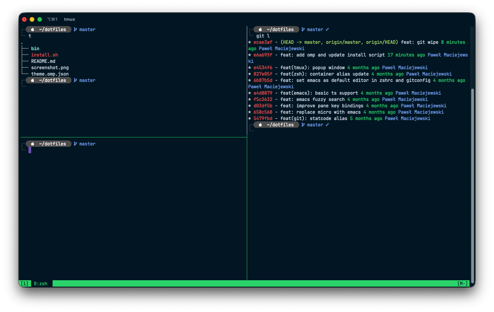

# Dotfiles

Dotfiles for zsh, git, emacs, tmux and Oh My Posh.



## Prerequisites

- [Homebrew](https://brew.sh) for installing missing tools
- git to clone this repository

## Installation

```shell script
git clone git@github.com:pwlmaciejewski/dotfiles.git && ./dotfiles/install.sh && source $HOME/.zshrc
```

The installer installs missing tools (git, tree, tmux, emacs, [Oh My Posh](https://ohmyposh.dev/docs/installation/macos), Node.js, and [branch-safe-name](https://github.com/pwlmc/branch-safe-name)) and the Fira Code Nerd Font. Configure your terminal to use the installed Nerd Font so the prompt icons display correctly.
